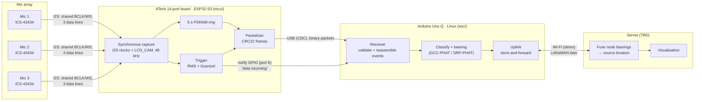

# Acoustic Chainsaw Detection

A 3-microphone acoustic sensor that listens for chainsaws and heavy machinery.
When it hears one, it captures synchronized audio, including the 4 s *before*
the trigger, and sends it upstream. There the direction of the sound is
estimated and the events are visualised.

## System overview



Plain-text version:

```
 Mic 1 ─┐                     ┌─────────────────────┐   USB (binary)    ┌───────────────────┐   Wi-Fi / LoRaWAN   ┌───────────────┐
 Mic 2 ─┼── I2S (shared ─────►│ ATech board ESP32-S3├──────────────────►│ Arduino Uno Q     │◄───────────────────►│ Server (TBD)  │
 Mic 3 ─┘    BCLK/WS)         │ capture · trigger · │── notify GPIO ───►│ Linux             │                     │ analysis ·    │
                              │ buffer · packetize  │   (port 6)        │ receive · forward │                     │ visualisation │
                              └─────────────────────┘                   └───────────────────┘                     └───────────────┘
```

## Responsibilities

| Layer | Hardware | Owns | Does **not** do |
|---|---|---|---|
| **MCU** ([`mcu/`](mcu/)) | ATech 14-port board, ESP32-S3, 2 MB PSRAM | • sample-synchronous 3-channel capture at 48 kHz<br>• rolling 6 s PSRAM history<br>• real-time trigger (RMS gate + Goertzel band ratio, debounce, cooldown)<br>• notify line HIGH during an event<br>• stream 4 s pre-trigger + up to 15 s live as CRC32-checked packets | networking, storage, direction finding |
| **SoC** ([`soc/`](soc/)) | Arduino Uno Q (Linux) | • keep the USB port open and read packets (must start within ~2 s of the event start)<br>• validate CRC/sequence numbers and reassemble events<br>• classify (chainsaw / machinery / other)<br>• **bearing per node** (GCC-PHAT / SRP-PHAT, board frame), on chainsaw-classified windows<br>• store-and-forward upload over Wi-Fi | real-time capture; locating the source from several nodes |
| **Server** (TBD) | — | • receive events + audio<br>• holds each node's position/heading; turns board-frame bearings into world directions; **intersects bearings from several nodes** to locate the source<br>• visualisation / alerting | — |

## Links

| Link | Medium | Carries | Notes |
|---|---|---|---|
| Mics → ESP32-S3 | I2S on ATech ports 1-2, 9-10, 13-14 | 24-bit audio, 16 bits kept | one clock fanned out to all mics |
| ESP32-S3 → Uno Q | USB (CDC, ESP32-S3 native USB on port 8) | binary event packets, ~288 KB/s live | see packet format in [`mcu/README.md`](mcu/README.md#6-streamer-and-packets-streamc-protocolc) |
| ESP32-S3 → Uno Q | GPIO, ATech port 6 D1 (3.3 V) | "data incoming", HIGH for the event | Linux is always on; no sleep/wake |
| Uno Q ↔ Server | **Wi-Fi (demo: everything)**; LoRaWAN later | event records + FLAC audio | LoRaWAN (~0.3–50 kbit/s) can't carry audio (~5.5 MB/event): later it would carry metadata (bearing, class, time) only |

## Repository layout

```
mcu/     ESP32-S3 firmware (ESP-IDF v5.5) + host tools (uv): see mcu/README.md
soc/     Arduino Uno Q / Linux side: App Lab app (soc/atech-serial-listener), laptop dev/tests (soc/dev)
sensor-sdk/  Python library the Uno Q app uses to classify and report events: see sensor-sdk/README.md
web/     the service on Cloudflare: landing page, researchers' dashboard, sensor API: see web/README.md
docs/    sensor API (docs/device-api.md), architecture decisions (docs/adr/)
```

## Test setup: 2000 Hz test tone (triggering + bearing + LED arrow)

A temporary mode for bring-up with a phone tone generator. It checks the whole chain:
- the ESP32 triggers on the tone;
- the Uno Q takes a bearing on it;
- the LED matrix points at it.

Real sounds don't make a good test in a loud venue: chainsaw clips are unreliable, and white noise didn't work in the hall. **It's off by default in both places. Turn it off again after testing.**

In this mode the tone bypasses the ESP32's coherence and band-ratio gates, and the SDK: tone hits light the LED but aren't sent to the server.

### Turn it on

1. **ESP32 firmware.** Set `CONFIG_FE_TEST_TONE_HZ=2000` in `mcu/sdkconfig`, or use `idf.py menuconfig` → *Acoustic Front-End → Trigger → TEST*. Then build:
   ```sh
   cd mcu && . ./idf-env.sh && idf.py build
   ```
   - A block counts as positive when mic 1's 2000 Hz bin is ≥ 20 dB above its ±150/200 Hz neighbours and the level is ≥ 6 dB above the noise floor.
   - The value must be a multiple of 50 Hz. Keep it ≤ 2300 Hz, or the bearing becomes ambiguous (the widest mic spacing is 7.2 cm).
2. **Flash it.** Either way:
   - ESP32 plugged into the laptop: `idf.py flash`.
   - ESP32 on the Uno Q's hub (no re-plugging): see [Flashing the ESP32 through the Uno Q](#flashing-the-esp32-through-the-uno-q).
3. **Uno Q app.** Set `"test_tone_hz": 2000` in the board's `~/ArduinoApps/atech-serial-listener/python/config.json`, then run `arduino-app-cli app restart user:atech-serial-listener`. The log shows `[test] TEST MODE: LED arrow for a 2000 Hz tone`.

### Run it

- **Play 2000 Hz** from about 1–2 m away.
  - An event should start within ~100 ms (5 × 20 ms blocks).
  - While the tone plays, the app logs `[test] tone 2000 Hz (NN dB) at DDD deg board frame` every 0.5 s.
  - The LED arrow holds for 10 s after the last hit.
  - The event ends 2 s after the tone stops, or 15 s after the trigger. After the 15 s cap it re-arms only after 2 s of quiet.
- **Watch it:**
  ```sh
  ssh arduino@<uno-q> 'arduino-app-cli app logs user:atech-serial-listener' | grep -E 'event start|\[test\]|\[led\]|event end'
  ```
  On the ESP32 itself, `uv run mcu/tools/monitor.py` (ESP32 on the laptop) shows `tone_db`. It's ≈ 5 dB on hall background, and the trigger needs ≥ 20 dB.
- **Without the Uno Q:** ESP32 on the laptop, `cd soc/dev && uv run run_local.py --test-tone 2000` prints the arrow in ASCII.

**Check the bearing, not just the arrow.** Stand at known positions around the ATech board and compare the *logged* bearing (board frame, counter-clockwise from +x):

| Tone from (seen from above) | Logged bearing |
|---|---|
| mic 2 side (ports 9-10 edge, away from mic 1) | ≈ 0° |
| top edge (the edge with mics 1 and 2, away from mic 3) | ≈ 90° |
| mic 1 side (ports 1-2 edge) | ≈ 180° |
| bottom edge (beyond mic 3) | ≈ 270° |

- **Arrow wrong, log right:** the Uno Q is mounted rotated relative to the ATech board. Fix it with `led.rotation_deg` in the board's `config.json`; **the current unit needs `-90`**. The arrow shows `bearing + rotation_deg`.
- **Log wrong as well:** the mic positions or mapping are off. Fix those, not the LED rotation, or the server receives wrong angles.

### Turn it off

1. Set `CONFIG_FE_TEST_TONE_HZ=0` in `mcu/sdkconfig`, rebuild and flash. The ESP32 then reports `tone_db=-99.0` in its `INFO` line.
2. Set `"test_tone_hz": 0` in the board's `config.json` and restart the app.

### Flashing the ESP32 through the Uno Q

No need to move the ESP32 off the Uno Q's hub. Build on the laptop, copy the images over, stop the app (it holds the serial port), and flash with esptool in a throwaway container:

```sh
cd mcu/build
tar -c bootloader/bootloader.bin partition_table/partition-table.bin acoustic_frontend.bin \
  | ssh arduino@<uno-q> 'rm -rf ~/fw-flash && mkdir ~/fw-flash && tar -x -C ~/fw-flash'
ssh arduino@<uno-q> 'arduino-app-cli app stop user:atech-serial-listener;
  DEV=$(readlink -f /dev/serial/by-id/usb-Espressif_*);
  docker run --rm --device=$DEV -v ~/fw-flash:/fw python:3.13-slim sh -c "pip install -q esptool &&
    esptool --chip esp32s3 --port $DEV --before usb-reset write-flash --flash-mode dio --flash-freq 80m --flash-size 8MB
    0x0 /fw/bootloader/bootloader.bin 0x8000 /fw/partition_table/partition-table.bin 0x10000 /fw/acoustic_frontend.bin";
  arduino-app-cli app start user:atech-serial-listener'
```

- **Keep the device's real name** (`--device=$DEV`, not renamed). esptool needs it to recognise the ESP32's built-in USB port.
- **`--before usb-reset`** is what puts the chip into download mode.
- The offsets come from `mcu/build/flash_args`.
