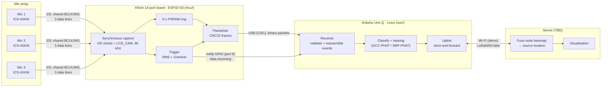

# Acoustic Chainsaw Detection

A 3-microphone acoustic sensor that listens for chainsaws and heavy machinery.
When it hears one, it captures synchronized audio, including the 4 s *before*
the trigger, and sends it upstream. There the direction of the sound is
estimated and the events are visualised.

## System overview



Plain-text version:

```
 Mic 1 ─┐                     ┌─────────────────────┐   USB (binary)    ┌───────────────────┐   Wi-Fi / LoRaWAN   ┌───────────────┐
 Mic 2 ─┼── I2S (shared ─────►│ ATech board ESP32-S3├──────────────────►│ Arduino Uno Q     │◄───────────────────►│ Server (TBD)  │
 Mic 3 ─┘    BCLK/WS)         │ capture · trigger · │── notify GPIO ───►│ Linux             │                     │ analysis ·    │
                              │ buffer · packetize  │   (port 6)        │ receive · forward │                     │ visualisation │
                              └─────────────────────┘                   └───────────────────┘                     └───────────────┘
```

## Responsibilities

| Layer | Hardware | Owns | Does **not** do |
|---|---|---|---|
| **MCU** ([`mcu/`](mcu/)) | ATech 14-port board, ESP32-S3, 2 MB PSRAM | • sample-synchronous 3-channel capture at 48 kHz<br>• rolling 6 s PSRAM history<br>• real-time trigger (RMS gate + Goertzel band ratio, debounce, cooldown)<br>• notify line HIGH during an event<br>• stream 4 s pre-trigger + up to 15 s live as CRC32-checked packets | networking, storage, direction finding |
| **SoC** ([`soc/`](soc/)) | Arduino Uno Q (Linux) | • keep the USB port open and read packets (must start within ~2 s of the event start)<br>• validate CRC/sequence numbers and reassemble events<br>• classify (chainsaw / machinery / other)<br>• **bearing per node** (GCC-PHAT / SRP-PHAT, board frame), on chainsaw-classified windows<br>• store-and-forward upload over Wi-Fi | real-time capture; locating the source from several nodes |
| **Server** (TBD) | — | • receive events + audio<br>• holds each node's position/heading; turns board-frame bearings into world directions; **intersects bearings from several nodes** to locate the source<br>• visualisation / alerting | — |

## Links

| Link | Medium | Carries | Notes |
|---|---|---|---|
| Mics → ESP32-S3 | I2S on ATech ports 1-2, 9-10, 13-14 | 24-bit audio, 16 bits kept | one clock fanned out to all mics |
| ESP32-S3 → Uno Q | USB (CDC, ESP32-S3 native USB on port 8) | binary event packets, ~288 KB/s live | see packet format in [`mcu/README.md`](mcu/README.md#6-streamer-and-packets-streamc-protocolc) |
| ESP32-S3 → Uno Q | GPIO, ATech port 6 D1 (3.3 V) | "data incoming", HIGH for the event | Linux is always on; no sleep/wake |
| Uno Q ↔ Server | **Wi-Fi (demo: everything)**; LoRaWAN later | event records + FLAC audio | LoRaWAN (~0.3–50 kbit/s) can't carry audio (~5.5 MB/event): later it would carry metadata (bearing, class, time) only |

## Repository layout

```
mcu/     ESP32-S3 firmware (ESP-IDF v5.5) + host tools (uv): see mcu/README.md
soc/     Arduino Uno Q / Linux side: requirements + design in soc/README.md (not started)
```
